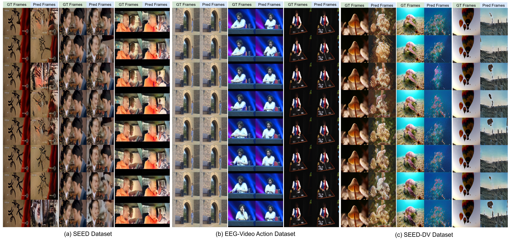
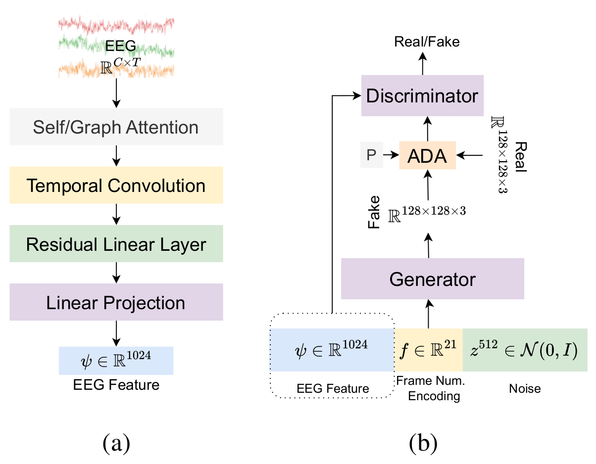
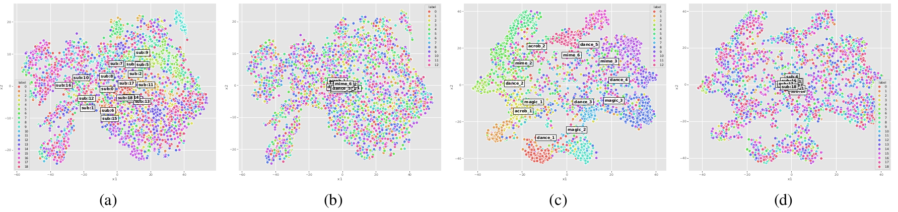
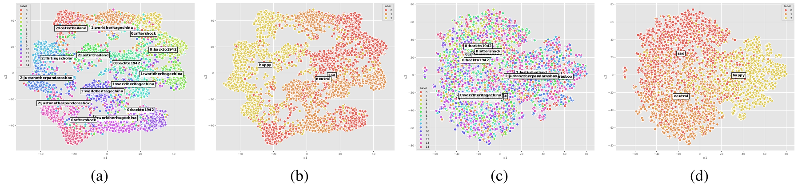
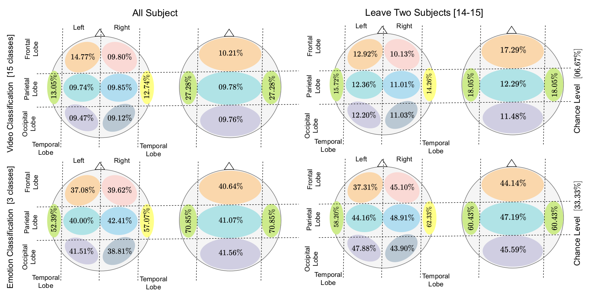
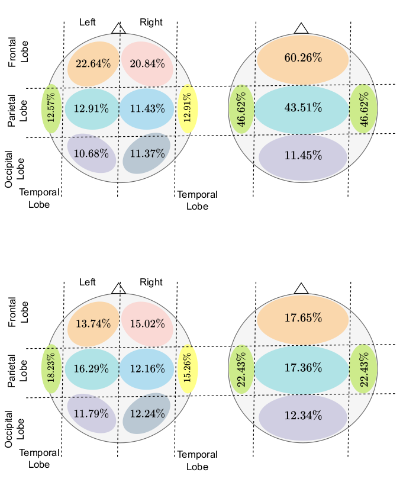
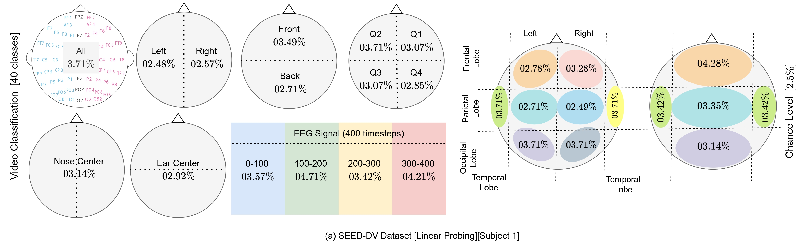

# Beyond Reconstruction: What EEG-to-Video Decoding Actually Recovers

[[Paper]](https://arxiv.org/abs/2505.21385) [[Project Page]](https://prajwalsingh.github.io/EEGVid/) [[Code]](https://github.com/prajwalsingh/EEGVid)



**Generated video frames from EEG.** Ground-truth and generated frames for clips shown to participants in SEED [1,2], EEG-Video Action [4] and SEED-DV [8]. Each clip has eight frames. The EEG provides semantic guidance, and the dataset-specific GAN prior provides fine spatial detail.

> **TL;DR.** Reconstruction scores alone cannot separate segment-specific decoding from a strong generative prior. Our controlled diagnostics show that EEG drives the stimulus-level content of the generated video, and provide a protocol for evaluating any EEG-to-video model.

---

## Abstract

Reconstructing *dynamic visual stimuli* from EEG recordings is challenging due to the noisy, non-stationary nature of EEG signals and the limited availability of EEG-video datasets. We present EEGVid, a framework that learns EEG representations using triplet loss and reconstructs dynamic videos with a temporally conditioned GAN. We study what these representations encode and how this information supports generation. First, visual representations retain emotional structure, while emotion-based supervision does not preserve the same fine-grained visual information. Second, triplet learning shifts EEG features away from subject-specific structure toward stimulus-related information. Third, analysis across brain regions, hemispheres, and time reveals consistent differences in visual and emotional encoding, with temporal regions contributing strongly across tasks. Finally, we evaluate video generation using three controlled diagnostics. The learned encoder separates unseen video classes better than a randomly initialized encoder, although the cross-subject gain is small, while mismatched EEG conditioning shifts generated content toward the substituted stimulus, showing that the generator actively uses EEG as a content signal. A ground-truth class label yields stronger reconstruction metrics, partly because the label is a cleaner conditioning target. Together, these results show that EEG exhibits a consistent visual and emotional structure that can support dynamic video generation, whereas current reconstruction primarily reflects coarse stimulus-level information rather than fine-grained, segment-specific decoding.

---

## Research questions

- **RQ1: How are visual and emotional features related?** In the SEED dataset, emotions are induced through video content. We test whether visual features also carry affective information. Our results show that emotional information is largely content-driven, with visual representations showing visible affective structure in t-SNE.
- **RQ2: Do learned visual features retain subject-specific information?** While untrained features cluster by subject, learned features emphasize stimulus information and reduce subject-related bias.
- **RQ3: How do different brain regions contribute to encoding?** We find that the temporal lobe, with only six channels, gives the highest accuracy in five of the six SEED and EEG-Video Action settings, the left hemisphere dominates for video classification and the right hemisphere for emotion, and, when training and test subjects overlap, frontal channels outperform posterior channels in both tasks.
- **RQ4: Can dynamic videos be reconstructed from EEG, and how much of this reconstruction reflects genuine segment-specific decoding?** By conditioning a GAN on EEG features and temporal indices, we show that generated frames align semantically with the videos participants observed. We then introduce three controlled diagnostics, i.e., a held-out-stimulus generalization test for the encoder, a mismatched-conditioning control for the generator, and a class-conditional baseline that compares EEG with a ground-truth label. These tests identify which aspects of the reconstruction the EEG drives.

---

## Method



**EEGVid framework.** (a) A modified NICE EEG encoder [6], trained with triplet loss, maps a 2-second EEG segment to a 1024-d unit-normalized feature. (b) A StyleGAN-ADA generator [7], trained from scratch with an added L1 loss to the ground-truth frame, synthesizes each frame from this feature concatenated with a sinusoidal encoding of the frame index.

- **EEG only.** The triplet loss pulls together segments from the same video and pushes apart different videos. No image or text model shapes the representation.
- **Frame-index conditioning.** The positional encoding uses 10 frequencies (21-d) for SEED and SEED-DV, and 2 frequencies (5-d) for EEG-Video Action. All EEG-Video Action results, including the diagnostics, use the same 5-d model.
- **Temporal conditioning.** Without the positional encoding, frames are almost static (optical-flow score 0.276 vs 0.896 with it, and 0.479 for real video, on EEG-Video Action). The frame index controls temporal variation, while the EEG controls content.

---

## Results

Ground-truth (GT) clips next to clips generated from EEG (Pred).

> Test clips are held-out 2-second segments of the videos in each dataset (random 80/10/10 split).

| Dataset | PSNR ↑ | SSIM ↑ | LPIPS ↓ | CLIP-Sim ↑ |
|---|---|---|---|---|
| SEED | 10.80 | 0.153 | 0.587 | 0.679 ± 0.037 |
| EEG-Video Action | 16.22 | 0.431 | 0.418 | 0.772 ± 0.022 |
| SEED-DV | 9.62 | 0.143 | 0.690 | 0.558 ± 0.023 |
| SEED-DV, EEG2Video [8] (reported) | – | 0.256 | – | – |

#### SEED Dataset
| Ground Truth | Predicted Output | Ground Truth | Predicted Output | Ground Truth | Predicted Output |
|

---

## What does EEG encode?

#### Effect of triplet loss


EEG-Video Action, t-SNE. A randomly initialized encoder clusters strongly by subject (a, 19 subjects) but not by video (b, 13 videos). After triplet training on video labels, the pattern reverses: features cluster by video (c, about 70% k-means accuracy) while subject clusters collapse (d).

#### Visual and emotional features


SEED, t-SNE. Trained on video labels, features cluster by video, and videos with the same emotion lie close together (a–b). Each video has a single emotion label, so this is not implied by the video clusters alone. Trained on emotion labels, features cluster by emotion but no longer separate videos (c–d).

#### Brain regions and time windows

| Setting | All channels | Left | Right | Front | Back |
|---|---|---|---|---|---|
| SEED video, all subjects (chance 6.67%) | 66.84 | **54.39** | 28.32 | **31.21** | 26.65 |
| SEED video, leave two subjects | 19.09 | **19.33** | 16.43 | **18.09** | 15.98 |
| Action video, all subjects (chance 7.69%) | 72.14 | **64.59** | 52.97 | **64.16** | 56.24 |
| Action video, leave two subjects | 24.09 | **24.19** | 17.65 | 17.77 | **18.57** |
| SEED emotion, all subjects (chance 33.33%) | 76.33 | 49.54 | **68.16** | **67.75** | 62.36 |
| SEED emotion, leave two subjects | 54.80 | 52.86 | **57.07** | 48.79 | **50.79** |

- The left hemisphere wins for video and the right hemisphere for emotion, in both regimes.
- Front beats back only when training and test subjects overlap.
- The temporal lobe is the most informative lobe across tasks (70.85% for SEED emotion, against 40.6–41.6% for the frontal, parietal and occipital lobes).
- Under the all-subjects regime, masking timesteps 100–300 (about 0.5–1.5 s of each 2-second window) lowers accuracy the most (SEED: 54.66 / 49.40 / 43.40 / 60.47% for the four masked windows; Action: 62.70 / 49.44 / 49.78 / 64.96%). For unseen subjects the effect is smaller on SEED and not observed on Action.



Brain lobes on SEED: accuracy when training and testing on channels from one lobe.



Region-wise and time-masked video classification on EEG-Video Action.



SEED-DV, subject 1, linear probing. All accuracies are at the 2.5% chance level, and masking some windows even raises accuracy above the unmasked 3.71%, so there are no clear regional differences on SEED-DV.

---

## Controlled diagnostics

All diagnostics use EEG-Video Action.

**Sanity check: random conditioning.** Replacing the EEG embeddings with random vectors from N(0, I) gives frames without class-consistent content. The generator relies on structured EEG input; control 2 tests whether it follows the specific trial.

**1. Held-out-stimulus generalization of the encoder.** The encoder is retrained four times, each time with a different set of videos held out of training and validation. On the held-out videos only, it is compared with a randomly initialized encoder (k-means over 20 seeds; nearest-neighbour retrieval).

| Held-out videos | k-means trained / random | All-pairs retrieval trained / random | Cross-subject retrieval trained / random | Same-subject share |
|---|---|---|---|---|
| 0, 1, 2 | 41.5 / 35.9 | 58.4 / 37.1 | 35.7 / 35.6 | 72.1% |
| 3, 4, 5 | 39.0 / 36.5 | 53.9 / 36.1 | 35.0 / 33.2 | 71.0% |
| 6, 7, 8 | 42.5 / 35.8 | 54.7 / 38.6 | 38.7 / 35.6 | 65.3% |
| 9, 10, 11, 12 | 28.7 / 27.4 | 43.8 / 27.7 | 26.7 / 26.0 | 67.5% |

The trained encoder beats the random encoder on every split in k-means accuracy (by 1.3 to 6.7 points, smallest on split 9, 10, 11, 12), and all-pairs retrieval gains 16–21 points. Restricting matches to different subjects separates stimulus from subject information: 65–72% of correct matches share the query's subject, and the cross-subject gain is 1.4 points on average (from 0.1 to 3.1 across splits), pointing to cross-subject alignment as the main lever for future encoders.

**2. Mismatched-conditioning control.** Each test segment's conditioning is replaced with that of a different (donor) trial at the same frame position. We then assign each output to its nearest CLIP class prototype (NPV).

| Condition | PSNR ↑ | SSIM ↑ | LPIPS ↓ | Donor class | Original class |
|---|---|---|---|---|---|
| EEG, correct | 16.22 | 0.431 | 0.418 | – | – |
| EEG swapped | 10.34 | 0.203 | 0.584 | 82.3% | 1.4% |
| Label swapped (class-label model) | 10.12 | 0.190 | 0.594 | 94.3% | 0.4% |

CLIP similarity to the donor prototype (0.893) exceeds similarity to the original (0.754). The generator uses EEG as a content selector and follows the stimulus class carried by the EEG.

**3. Class-conditional baseline.** An identical generator is trained with a one-hot trial label in place of the EEG feature (30,096 test segments).

| Conditioning | PSNR ↑ | SSIM ↑ | LPIPS ↓ | CLIP-Sim ↑ |
|---|---|---|---|---|
| EEG feature | 16.22 | 0.431 | 0.418 | 0.772 |
| Ground-truth label | **17.13** | **0.620** | **0.285** | **0.866** |

The label is a cleaner, easier target: it is followed more strictly when swapped (94.3% vs 82.3%). Its outputs are not collapsed (generated vs real diversity 0.258 vs 0.265 mean pairwise LPIPS). The label therefore serves as a class-level reference, and closing the gap calls for encoders that recover segment-level information from EEG.

**Bottom line.** EEG carries stimulus-level information that the generator uses as a content selector. These controls give a more informative basis for evaluating EEG-to-video models than reconstruction scores alone. They need no change to the generator and apply to any architecture. Natural next steps are datasets with repeated presentations, within-class swaps, held-out-video generation, and encoders with stronger cross-subject alignment.

---

## Datasets

| Dataset | Subjects | Stimuli | Labels | Channels | Link |
|---|---|---|---|---|---|
| SEED [1,2] | 15 (×3 sessions) | 15 clips, ~4 min each | 15 videos / 3 emotions | 62 (ESI NeuroScan [3]) | [Link](https://bcmi.sjtu.edu.cn/home/seed/seed.html) |
| EEG-Video Action [4] | 19 | 13 muted single-shot videos | 13 videos | 64 (BioSemi ActiveTwo [5], 2048 Hz) | [Link](https://zenodo.org/records/10512414) |
| SEED-DV [8] | 20 | 1400 clips | 40 concepts | 62 | [Link](https://bcmi.sjtu.edu.cn/home/eeg2video/) |

All EEG is resampled to 200 Hz and cut into non-overlapping 2-second segments (400 timesteps) aligned with the video. For SEED and EEG-Video Action, the segments of each video are randomly split 80/10/10 into train/validation/test. In the leave-two-subjects regime, the last two subjects form the test set. SEED-DV follows the 7-fold block protocol of EEG2Video [8].

---

### Preprocessing

1. Create a directory named `dataset` in a desired parent directory

#### SEED Dataset

Perform the following steps to create EEG and video segment pairs:


1. Create a directory named `SEED` inside the `dataset` directory
2. Store the `Preprocessed_EEG` directory downloaded from SEED dataset source inside `dataset/SEED` directory
3. Store `video_chunks` inside `dataset/SEED` directory.
4. Update the variable named `PATH_TO_DATASET` in `./Preprocessing/0.SEED/splitter_2.py`
5. Run `./Preprocessing/0.SEED/splitter_2.py`. The EEG segments will be stored in `dataset/SEED/eeg_video_dataset_random_split_v2_tokens`

#### EEG-Video Action Dataset

1. Create a directory named `ACTION` inside the `dataset` directory
2. Store the `SingleShot` datadir downloaded from EEG-Video Action dataset source inside `dataset/ACTION` directory
3. Update the variable named `path_to_dataset` in `./Preprocessing/1.ACTION/segment.py`
4. Run `./Preprocessing/1.ACTION/segment.py`. The EEG segments will be created in a new directory inside `dataset/ACTION/Preprocessed_SingleShot` directory
5. Store all the downloaded videos at `dataset/ACTION/SingleShotVideo`
6. Update the variable named `path_to_dataset` in `./Preprocessing/1.ACTION/chunck_video.py`
7. Run `./Preprocessing/1.ACTION/chunck_video.py`. The video segments will be created inside `dataset/ACTION/Preprocessed_SingleShot` directory
8. EEG segments and videos can be paired using the names of the EEG and video files because the segment names match

---

## Running the controlled diagnostics

Each diagnostic lives in its own directory with its own `training/dataset.py`. To train a generator for an experiment, use that directory's `training/dataset.py` in place of the default one in the EEGStyleGAN-ADA training code, then train as usual. All diagnostics use the 5-d positional encoding.

**1. Held-out-stimulus encoder** (`exp1_encoder_holdout/`). Trains one encoder per held-out split and evaluates it against a random encoder.

```bash
# check class balance of the splits without training
python run_multi_split.py --dry-run --train-path /path/to/action/train \
    --splits "0,1,2" "3,4,5" "6,7,8" "9,10,11,12"

# train and evaluate all splits
python run_multi_split.py \
    --train-path /path/to/action/train --val-path /path/to/action/val --test-path /path/to/action/test \
    --exp-type all --num-classes 13 --device cuda \
    --splits "0,1,2" "3,4,5" "6,7,8" "9,10,11,12" --out-dir multi_split_results/
```

**2. Mismatched-EEG control** (`exp2_mismatched_eeg/`). Inference only, on the main EEG-conditioned generator.

```bash
python mismatched_eeg_control.py --pkl /path/to/eeg_generator.pkl --data /path/to/action/test --out exp2_results.json
```

**3. Class-conditional baseline** (`exp3_class_conditional/`). Train a generator with this directory's `training/dataset.py` (one-hot label + frame position), then:

```bash
python eval_classcond.py              --pkl /path/to/classcond.pkl --data /path/to/action/test --out exp3_eval.json
python mismatched_class_control.py    --pkl /path/to/classcond.pkl --data /path/to/action/test --out exp3_mismatch.json
python mode_collapse_diversity_check.py --pkl /path/to/classcond.pkl --data /path/to/action/test --out exp3_diversity.json --save-dir diversity_panels/
python z_consistency_check.py         --pkl /path/to/classcond.pkl --out exp3_z.json --save-dir z_grid/
```

---

## References
1. W.-L. Zheng and B.-L. Lu. *Investigating Critical Frequency Bands and Channels for EEG-based Emotion Recognition with Deep Neural Networks*. IEEE TAMD, 7(3):162–175, 2015.
2. R.-N. Duan, J.-Y. Zhu and B.-L. Lu. *Differential Entropy Feature for EEG-based Emotion Classification*. IEEE/EMBS NER, 81–84, 2013.
3. Compumedics NeuroScan. *ESI NeuroScan System*. [compumedics.com.au/products/neuroscan](https://www.compumedics.com.au/products/neuroscan/).
4. Y. Yao, A. Stebner, T. Tuytelaars, S. Geirnaert and A. Bertrand. *Identifying Temporal Correlations Between Natural Single-shot Videos and EEG Signals*. Journal of Neural Engineering, 21(1):016018, 2024.
5. BioSemi. *ActiveTwo EEG System*. [biosemi.com](https://www.biosemi.com).
6. Y. Song, B. Liu, X. Li, N. Shi, Y. Wang and X. Gao. *Decoding Natural Images from EEG for Object Recognition*. arXiv:2308.13234, 2023.
7. T. Karras, M. Aittala, J. Hellsten, S. Laine, J. Lehtinen and T. Aila. *Training Generative Adversarial Networks with Limited Data*. NeurIPS, 33:12104–12114, 2020.
8. X.-H. Liu, Y.-K. Liu, Y. Wang, K. Ren, H. Shi, Z. Wang, D. Li, B.-L. Lu and W.-L. Zheng. *EEG2Video: Towards Decoding Dynamic Visual Perception from EEG Signals*. NeurIPS, 37:72245–72273, 2024.
